# Velos Infer 设计文档

## 一\.整体架构设计：

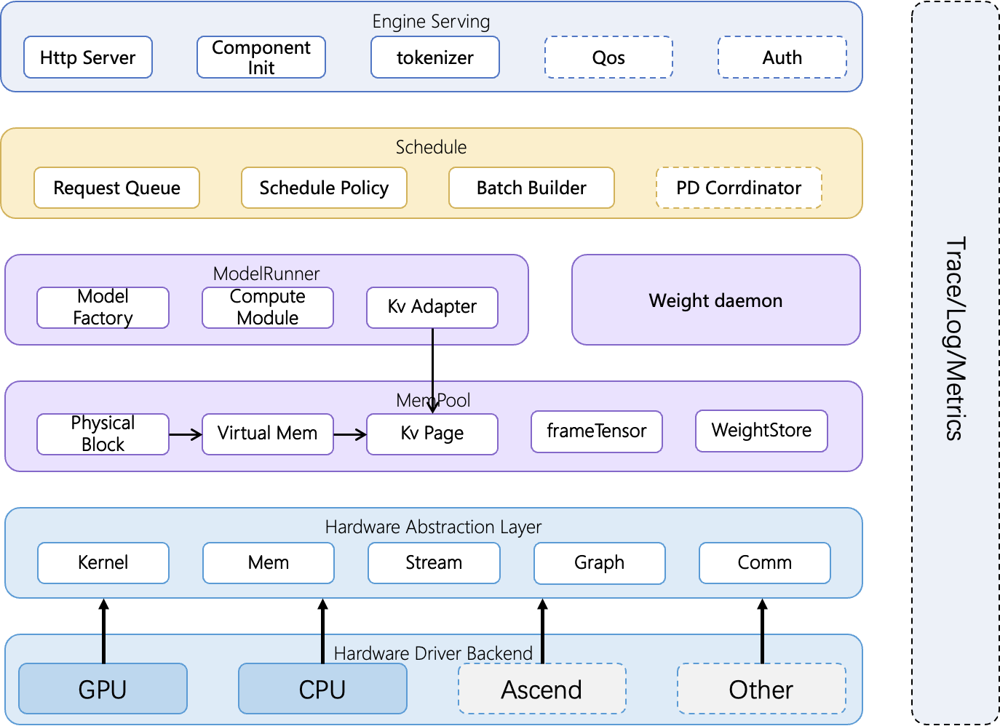

- Hardware Driver Backend：

不同的硬件提供基于抽象接口的不同驱动实现，当前实现了GPU和CPU两个版本的实现。实现内容包括：算子、内存驱动接口，Stream管理，Graph接口和通信接口。

- Hardware Abstraction Layer：

对上提供统一的硬件驱动抽象语义用来屏蔽不同的硬件差异。初始化backend实例后，上层不再感知硬件差异，通过具体backend\-ctx来执行各种算子以及HAL接口。

- MemPool：

整个系统主要由三种内存类型，一种是随着系统负载不断变化的kvCache，因为prefixCache的存在，请求结束也会保留在显存中；一种是中间激活值和算子的workspace，有上限峰值，请求结束后释放。最后一种是常驻显存不变的，生命周期跟进程一致的权重tensor。memPool模块主要管理这三类显存。

- ModelRunner：

主要是用来组装不同模型的计算流，提供一些可复用的module组件，无计算图概念，无JIT编译、极简的静态模块拼装，极低的时延开销。

- Weight Daemon：

权重显存由单独的进程管理，为后续推理进程的快速恢复以及热补丁打下基础，通过IPC传递权重的元数据信息以及显存句柄。

- Schedule:

schedule主要对接tokenizer处理好之后的请求，以及返回给detokenzier。schedule loop 主要根据策略来负责处理三种队列：Admission、Running、Waiting，同时会根据预算来组batch，每个batch的prefill和decode的token数量。同时还抽象了schedule policy，后续可以根据系统负载情况自定义调度策略。

- Engine Serving:

主要承载http请求、模块初始化、tokenizer、启动参数解析等一些服务化功能。

代码地址：https://github.com/VelosInfer/   （待开源）

## 二\.内存管理

内存管理是整个推理系统最复杂的模块之一，参考了多个开源实现，并以当前transformer网络结构下的内存特点来进行设计的。

内存管理主要有三类：KVCache、FrameTensor、WeightTensor。WeightTesnor因为是静态不变的，就直接调用HAL内存分配接口即可，具体逻辑可查看第七节。这一节主要讲KVCache和FrameTensor。

### kvCache显存布局：


当前kvCache的种类繁多（Dense、SSM、SWA、C4、C128），开源社区的设计多数是静态分配的机制（给不同的KvCache固定上限容量），并搭配复杂的关联匹配逻辑。

为了让KVCache内存具备流动性并简化上层编码的心智负担，在kvCacheManager侧抽象了两层：

- **Vmm**

kvPage不再是建立在具体物理地址上，而是固定一整段虚拟地址，在系统负载达到一定水位之后按需的去大颗粒的map/unmap。这样做有三个好处：一个是Physical block可按需在不同种类的cache pool直接流动而不会影响上层的地址和编码逻辑，第二个是固定了Cache base的虚拟地址有利于图的捕获，第三个是可以超配地址空间，固定远大于实际需求的内存地址空间，不用在初始化时做复杂的配比计算，同时不同pool不会相互影响。

- **Token语义**

对上只提供token级的语义，**不感知实际的page容量以及内存排布**，不同的pool可以定义不同的page承载的token大小，避免强制对齐带来的内存浪费，每个pool提供统一的抽象接口


除此之外kvCache还根据算子特点和社区重构方向提供了两种数据排布：LayerMajor Layout和 TokenMajor Layout，后续如果有新的layout出现，只需要注册新的layout接口即可，做到了开闭原则

- LayoutMajor Layout：

当前主流的内存排布方式，每一层的kvCache地址是按token位置连续排布（同一种类型Cache），减少了atten类算子寻址范围，因此虚拟地址预留时也是按层数等分了虚拟地址空间，对于地址空间来说会出现以下排布情况，有效和未使用地址交替


因为对上是提供token语义的page，所以申请比如单个token的page时，返回page的描述符里面虚拟地址是散列排布的。

- TokenMajor Layout：

    以token为粒度的连续内存排布，把一个token的每一层的cache放在连续的地址空间，返回page的描述符里面的虚拟地址是连续排布的。


### Frame Tensor 显存布局：

内存相关的还有一个是激活值和算子workspace这些临时申请的，这类显存管理主要考虑到了两点：一是需要避免频繁的申请释放从而引入时延，二是要尽量保证地址稳定从而为cuda graph做铺垫。所以velos Infer会预先申请一大段内存，然后把网络层的每一层显存当作栈上内存来管理，每一层计算逻辑申请的tensor都会都会在层结束时释放内存，释放内存也只是对大段内存的使用游标进行偏移。

这样设计既避免了频繁的申请释放，也尽可能的减少了显存的开销同时保证了tensor地址的稳定。但是需要提前计算预留的内存空间，所以在算子执行的模式上新增了sizing模式，这个模式下，算子不会去launch，但是其他逻辑保证不变，在这个模式下统计显存的峰值，实际执行时就按照峰值来预留内存段。如上图所示，在layerN的时候达到了显存峰值。

### kvCache管理:

PrefixCache当前和KvCache是解耦的状态，prefixCache只管理前缀匹配和对应的实际page，而不管底层Cache细节。我们加上prefixCache之后来看看各个组件的关系：

推理进程会有个全局的kvCacheManager，kvCacheManager管理多个kvPool，每个kvPool都有相同的抽象接口给kvCacheManager调用，cachePool会有和虚拟地址管理器，来处理与driver的交互以及map和unmap。除此之外，还有个比较重要的是我们给当前的Cache抽象了两类，Append和Roll。

Append 和 roll是抽象出来的两种kvCache管理策略，一种是跟随token增长不断增长的，一次请求内不会淘汰，它有一个参数压缩率，full就是1，c4就是4，c128就是128。一种是Roll，会不断淘汰的，有个淘汰窗口，swa就是windows size, SSM就是1。

### PrefixCache：

当前引擎借鉴了sglang的数据结构，用radixTree来管理prefixCache，原因主要是为了灵活性，树的node所覆盖的token范围可以是不固定的，这样对于system prompt来说就没必要切成一个个块来做hash匹配了。

整个树的拓扑结构是靠着slot index来映射的，每个node会去radixTree上申请一个slot号作为nodeID，同时会有对应的内存空间，里面存放了父节点的ID、儿子节点的ID list、该node代表的tokens片段以及对应的kvPage\(PrefixSegment\)。同时还有个代际号，会保护matchPrefix 找到Node过后，执行淘汰操作时把Node逐出带来的ABA问题。

每一种pool都有自己的checkpoint粒度，最后复用的时候需要找到最小的公倍数的倍数来进行复用和重计算，后续想分pool复用就拿各自的匹配位置。

上层可以通过设置checkpoint粒度，把所有pool拉齐，减少当前的缓存消耗。Prefix管理本质是token前缀管理，内存相关的由kvCacheManager管理，不同的token片段会形成链表或者树结构，每个片段下面挂一个prefixSegment里面有这个片段的page页号。

对于hash来说，每一个node必须是定长的，对于radixTree来说每个node其实可以变长，Prefix和Kv管理解耦开，kvManager不用关心上层怎么实现前缀缓存，只提供对应的segment描述就好

## 三\.engine

### Engine模块设计：

Engine 是启动和编排层，负责把配置、设备、权重、模型、KV cache、ModelRunner 和 Scheduler 按依赖顺序组装起来。启动完成后，命令循环交给每个 rank 内的 SchedulerCore，EngineCore 负责 rank 线程的创建、锁步和退出。

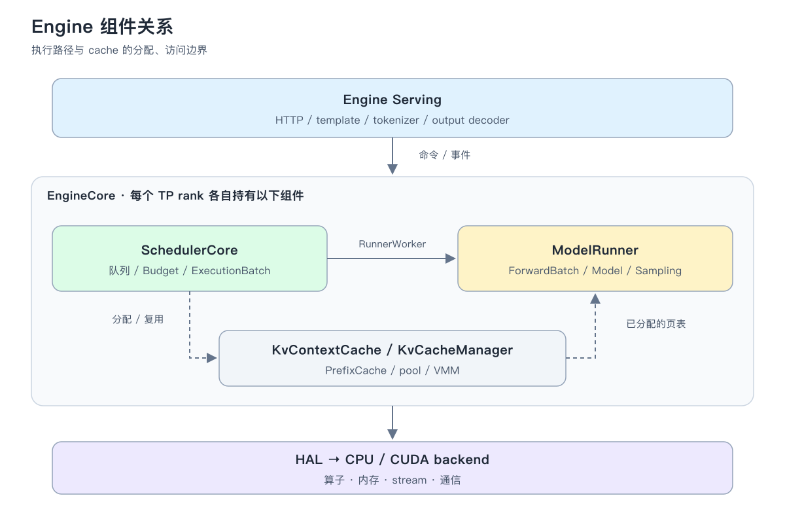

- **Engine Serving：**承载 HTTP、tokenizer、prompt/output 线程，并把命令和事件通道交给 EngineCore。

- **EngineCore：**检查全局配置，创建 TP rank 线程，协调启动阶段，并在所有 rank 就绪后返回 EngineInfo。

- **DeviceContext：**由 HAL backend 打开，向本 rank 提供 allocator、stream、capabilities 和 collective provider。

- **Resident weights：**从 weight daemon attach 权重 slab；没有权重目录时创建确定性的随机权重。

- **Model / KV / Runner / Scheduler：**按组件依赖完成构造和连接，运行期由各组件维护自己的状态。

Engine 的主链路如下：

```text
EngineConfig
    -> TP rank threads
    -> read model config
    -> open DeviceContext and TP communicator
    -> attach or create resident weights
    -> build Model
    -> build KV pools and ModelRunner
    -> build SchedulerCore
    -> signal ready
    -> run command loop
```

### Engine启动：

#### 配置入口

**EngineConfig** 是 Engine 的唯一启动配置。`config_path` 用于读取模型族、层类型和最大上下文长度；`weights_dir` 指定 weight daemon 的发布目录，为空时使用随机权重；`spec` 指定 TP 布局，当前要求 `ep = 1`；`max_model_len`、`max_num_seqs` 和 `max_num_batched_tokens` 共同限定服务和 cache 的容量；`kv_cache_tokens`、`prefix_state_slots` 可以覆盖 KV pool 和线性状态快照的预留大小。

Engine 在启动阶段校验 TP/EP 组合、容量和设备数量；模型 shape、算子能力和 cache layout 在对应组件初始化时完成校验。

#### `EngineCore::spawn`

`spawn` 先完成配置检查，再为每个 TP rank 创建一个线程。rank 0 使用调用方传入的 command/event channel，其他 rank 使用 `FollowerSource` 重放 rank 0 的命令轮询结果。每个 rank 的对象都在自己的线程内创建和持有，模型借用 resident weights，cache、runner 和 worker 共享 rank 内的状态。

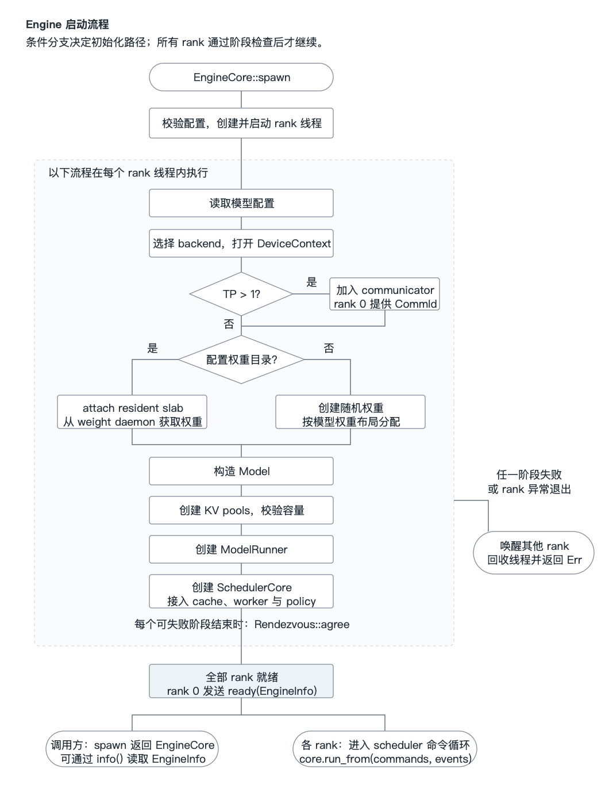

启动流程中的每个可失败阶段都通过 `Rendezvous::agree` 汇总结果。任一 rank 失败时，其他 rank 会被唤醒并一起退出；所有 rank 完成初始化后，rank 0 通过 `ready` 通道返回 `EngineInfo`，`spawn` 随后返回。

### rank生命周期与TP：

每个 rank 按下面的顺序建立运行环境：

1. 读取 `config.json`，识别 `ModelFamily`，确定最大上下文和线性注意力配置。

2. 通过 Registry 选择 backend，按 rank 打开一个 `DeviceContext`。

3. TP 大于 1 时由 rank 0 生成 `CommId`，所有 rank 加入同一个 communicator。

4. 调用 resident loader attach 权重 slab，或根据权重布局分配随机权重 slab，并校验 metadata。

5. 使用 `ModelFamily::build_model` 构造模型，模型层只借用已经驻留的权重。

6. 根据模型层类型和 sizing 配置构造 KV pools、VMM reservation 和 page limits。

7. 创建 `ModelRunner`，绑定 context、TP spec、KV manager 和 communicator。

8. 创建 `KvContextCache`、`RunnerWorker`、`FcfsPolicy` 和 `SchedulerCore`。

```text
ModelFamily + WeightLookup
          |              \
          v               v
      Model          KV cache manager
          \               /
           v             v
             ModelRunner
                  |
                  v
             RunnerWorker
                  |
                  v
            SchedulerCore
```

Engine 沿着这条依赖链完成对象初始化和错误传播；page 分配、模型 forward、请求选批分别通过 KV、runner 和 scheduler 的接口执行。

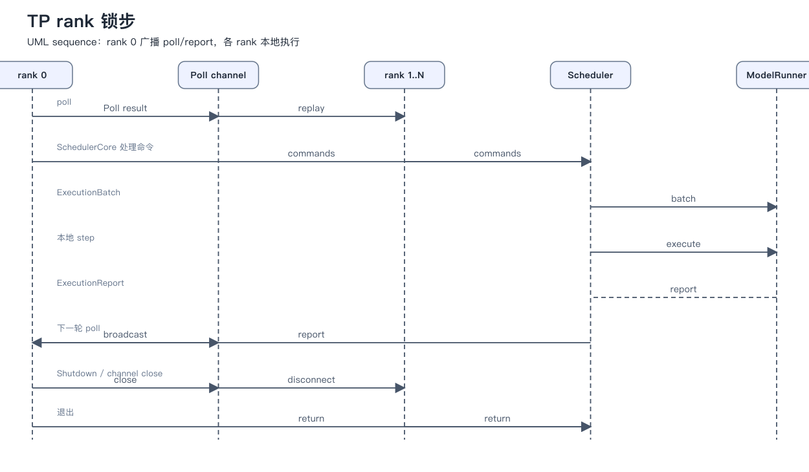

每个 TP rank 持有一套完整的 `SchedulerCore`、`KvContextCache` 和 `ModelRunner`。rank 0 转发每次命令 poll 的结果，保证 follower 在相同的 batch 边界处理命令；每一步执行后，rank 0 再转发 `ExecutionReport`，让各 rank 的请求历史保持一致。模型内部的 collective 在各自 rank 的 step 中执行。

### 启动阶段的所有权、错误与退出：

- **所有权：**`EngineCore` 持有每个 rank 的线程句柄；rank 线程持有 `DeviceContext`、resident weights、model、KV state、runner 和 scheduler。

- **借用关系：**model 借用 weights；runner 借用 model 和 KV manager 所需的描述；worker 通过共享的 rank 内 KV state 访问页表。

- **通道关系：**rank 0 持有服务侧 command/event channel；follower 通过 poll/report channel 参与锁步。

这种所有权安排使设备资源不会被多个 rank 线程隐式共享，也让 Engine 可以在 rank 线程退出时按顺序释放组件。

每个启动阶段都通过 `Rendezvous::agree` 汇总结果。任一 rank 在读取配置、打开设备、加入 communicator、加载权重、构造模型或创建 runner 时失败，所有 rank 在同一阶段返回错误。设备完成检查返回 `DeviceLost` 后，Engine 将 rank 的 KV state 标记为不可复用，并隔离可能仍被设备访问的权重和 cache storage。

正常退出由 command channel 关闭或 `Shutdown` 触发。rank 0 的 scheduler 结束后，follower 通过关闭的 poll channel 退出，`EngineCore::join` 按 rank 顺序回收线程并返回首个错误。

## 四\.schedule

### 概述

#### 定位：

Scheduler 是 velos\-engine 的运行期调度层，位于 Engine Serving 与执行层之间。从 prompt 线程接收请求，每次step在 token 预算（Budget）内选出一个批次，向 KV cache 申请槽位，交给 ModelRunner 执行，再把确认的 token 按顺序发给 output 线程。

#### 设计原则：

- **调度事实归 Scheduler**：请求历史、已计算数和队列由 Scheduler 持有，页表和前缀树由 KV cache 持有。Scheduler 中不出现 block、page、slot 或设备地址。

- **策略与机制分离**：SchedulingPolicy 决定取哪些请求、按什么顺序、切多大、何时抢占；Core 负责 lookup、截短、对齐、分配和扣账，并检查策略是否违反规则。

- **wait 之后才动资源**：登记已计算前缀、释放页表和抢占都发生在相关批次 wait 返回之后，KV 资源不需要 fence，也不需要批次级回滚。

- **有界推进**：“当前容量不足”与“独占也放不下”分开报告，单轮抢占次数有上界，不会陷入分配失败、抢占、再失败的循环。

#### 当前范围：

- 每个 rank 一个 SchedulerCore，配一个 Worker 和同进程的同步 KV cache；TP 下各 rank 的 Scheduler 锁步运行。

- 输入是 token 序列；tokenizer、chat template 和 HTTP 由 Engine Serving 负责。

### 模块设计

#### 模块组成：

Scheduler 由三个核心模块和一个策略对象组成。SchedulerCore 是唯一的具体类型。

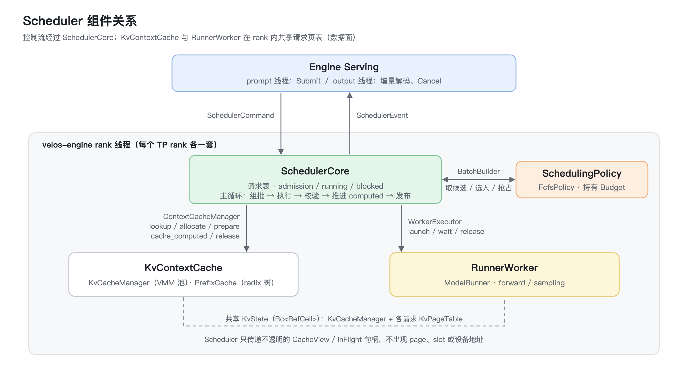

- **SchedulerCore**：持有请求表、三个队列和主循环；处理命令、组批、驱动执行、校验结果、推进已计算数并发布事件。

- **SchedulingPolicy**：持有自己的 Budget，通过 BatchBuilder 决定候选顺序、切片上限和抢占对象；默认实现是 `FcfsPolicy`。

- **ContextCacheManager**：前缀查询、槽位分配、生成执行视图、登记已计算前缀和释放。

- **WorkerExecutor**：派发并等待一个批次，返回每个请求的采样结果。

### 请求与队列

#### 请求表与三个队列：

Core 内部保存一个请求表和三个队列。队列只存 `RequestId`，请求数据都在请求表里；每个未结束的请求恰好位于一个队列。

```Plain Text
requests:  HashMap<RequestId, RequestRuntime>
admission: VecDeque<RequestId>   // 被抢占的请求在队首，新请求按到达顺序在后
running:   VecDeque<RequestId>   // 已持有页表的请求，保持准入顺序
blocked:   VecDeque<RequestId>   // 等待 Engine 补齐 prompt
```

`RequestRuntime` 记录的内容：

- `tokens` 与 `prompt_len`：prompt 加已确认输出，Core 在末尾原地追加，不在每步拷贝整段历史。

- `computed`：已计算数，`[0, computed)` 的 KV 已写入且可读。

- `checkpoint_hint`：Cache 建议的停步位置。

- `max_new_tokens`、`sampling`、`namespace`：来自请求。

prefill 和 decode 不分队列，由位置关系决定。

#### 状态流转：

请求在三个队列之间的流转如下：

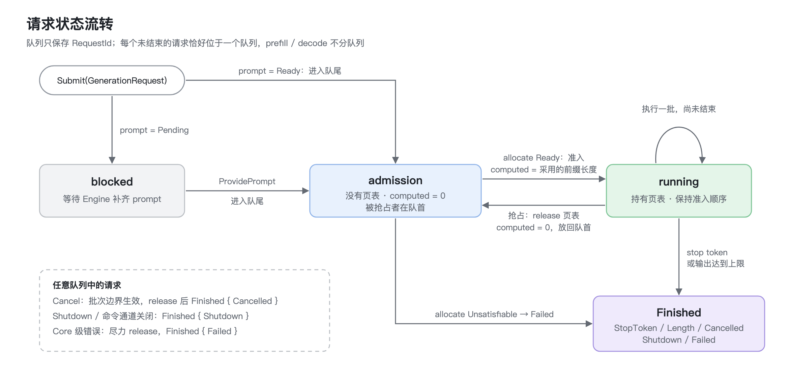

|触发|队列变化|
|---|---|
|`Submit`，prompt 为 `Ready`|进入 admission 尾部|
|`Submit`，prompt 为 `Pending`|进入 blocked|
|`ProvidePrompt`|blocked → admission 尾部|
|allocate 成功（首次准入或抢占后恢复）|admission → running 尾部<br>|
|执行一批后尚未结束|留在 running|
|抢占|running → admission 队首，`computed` 清零|
|stop token、长度上限、取消、关闭|release 后移出队列，发送 `Finished`|
|allocate 返回 `Unsatisfiable`|release 后移出队列，发送 `Finished { Failed }`|

#### 已计算数：

KV 已经算到哪里只由 Scheduler 记录。KV cache 不维护另一份进度，也不会绕过 Scheduler 缩短它。

|事实|数据管理|说明|
|---|---|---|
|已确认输出历史|Scheduler|已发布的 token，抢占时保留|
|已计算数 `computed`<br>|Scheduler|`[0, computed)` 的 KV 可读|
|已分配槽位 `KvPageTable.tokens()`|KvCacheManager|allocate 成功即推进，执行完成前会超过 `computed`|
|已缓存前缀与 joint 恢复位置|PrefixCache<br>|只按所有池都能恢复的 joint 位置采用|
|`checkpoint_hint`|Cache 提议，Scheduler 保存|只是停步建议，不代表已有该位置的状态|

### 调度循环

#### 主循环：

当前实现是同步循环：每一步规划一个批次，launch 之后立即 wait，确认结果后再进入下一步。一步之内各模块的调用顺序如下：

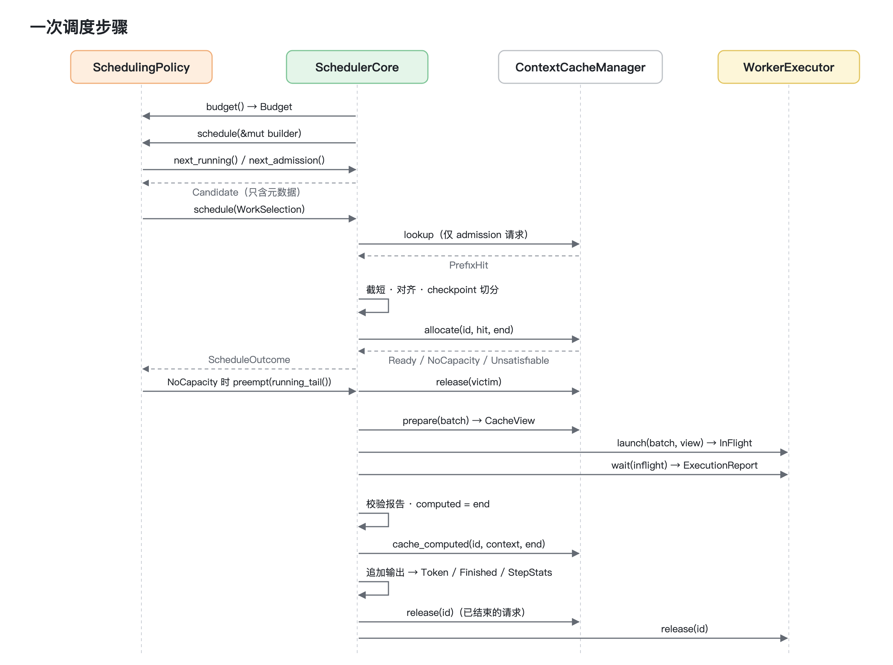

### 预算与调度策略

#### Budget：

Budget 是每个批次目标模型计算量的硬上限，由策略持有；Core 每次规划前调用 `policy.budget()` 取得本批预算，只负责校验和扣账。四项同时生效，total 不要求等于 prefill 与 decode 之和：

- `total_tokens`：本批计算位置总数。

- `prefill_tokens`：prompt 内的计算位置数。

- `decode_tokens`：prompt 之后的计算位置数，包括 decode 和抢占后的历史回放。

- `max_requests`：本批请求数。

一个工作项计算 `[s, e)`、prompt 长度为 P 时：

```Plain Text
prefill_charge = max(0, min(e, P) - s)
decode_charge  = (e - s) - prefill_charge
total_charge   = e - s
```

## 五\.model build/runner

## 六\.HAL

### HAL分层：

HAL 屏蔽 CPU/CUDA 差异，并定义 Engine 与具体 backend 之间的设备、内存、stream 和算子契约。初始化 backend 后，上层通过 `DeviceContext` 和 `Executor` 提交工作，具体 kernel 和 vendor API 留在 backend 内部。

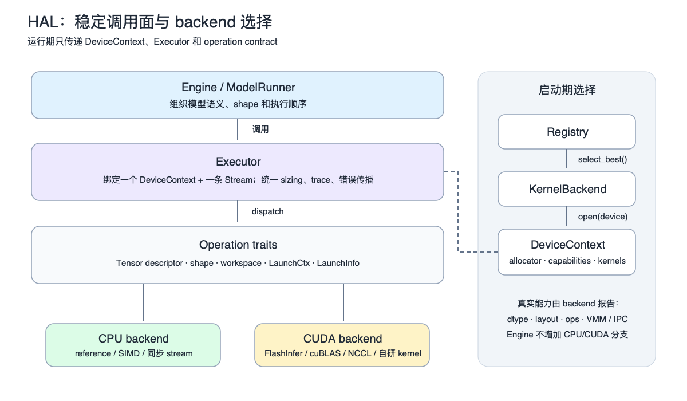

- **hal\_api：**定义 tensor descriptor、内存类型、stream、operation trait 和错误语义。

- **Registry / Capabilities：**发现可用 backend，并声明当前 build/runtime 真正支持的 dtype、算子和可选服务。

- **DeviceContext：**保存设备属性、allocator、default stream、capabilities、collective provider 和 optional services。

- **Executor：**将 context 与一条 stream 绑定，为 ModelRunner 提供稳定的 per\-stream 调用面。

- **Backend：**实现设备枚举、内存、kernel 变体、event、VMM 和通信。

请求队列、模型层组合和 prefix cache 通过 Engine/ModelRunner 组织；HAL 提供 `gemm`、`paged_prefill` 等算子，模型层将这些算子组合成 `qkv_proj` 等模型语义。

### backend初始化：

#### 对象与生命周期

```text
Registry
   -> KernelBackend
        -> DeviceContext
             |-> allocator / default stream
             |-> Capabilities / optional services
             +-> Kernels
                    -> Executor（每条 stream 一个）
```

`Registry` 是进程级 backend 目录；`KernelBackend` 负责枚举设备和打开 context；`DeviceContext` 持有设备运行期资源；`Executor` 由调用方显式创建并绑定一条 stream。运行期的 context 和 stream 通过显式对象传递。

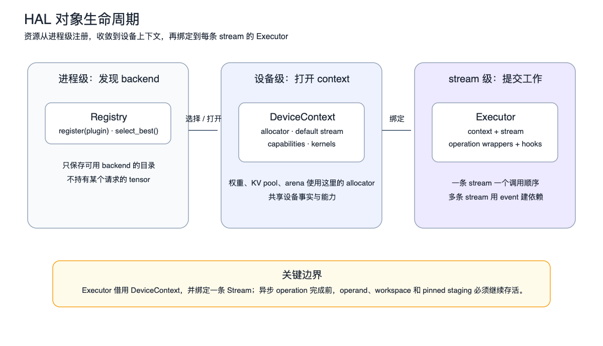

#### 设备事实与能力

`DeviceProperties` 描述硬件事实，例如架构、显存、计算单元、SIMD width 和 peer devices；`Capabilities` 描述当前实现可以执行的路径，包括 dtype、quantization scheme、scale layout、operation groups、VMM、IPC、pinned memory 和 graph 等能力。Engine 在启动时读取 capabilities，选择模型执行路径和必要的 materialize 操作；operation 继续校验具体的 dtype、shape、layout 和 workspace。

### tensor、memory 和 stream：

#### Tensor 与内存

`TensorRef` / `TensorMut` 是带设备和生命周期的借用视图，descriptor 记录 dtype、shape、layout 和 strides。view 操作只改变 descriptor；需要真正进行 strided 到 contiguous 的转换时，调用 `TransformOps::materialize`。

`DeviceAllocator` 提供 Device、HostPinned 等分配原语，`Workspace` 表示调用方提供的临时 scratch。权重、KV pool 和 activation arena 按各自生命周期持有这些内存。

#### Stream 与异步完成

Stream 承载 copy、event、synchronize 和 priority。提交后的工作异步执行，调用方在设备完成前保持 operand、workspace 和 pinned staging 存活；跨 stream 复用数据时用 event 依赖或同步。

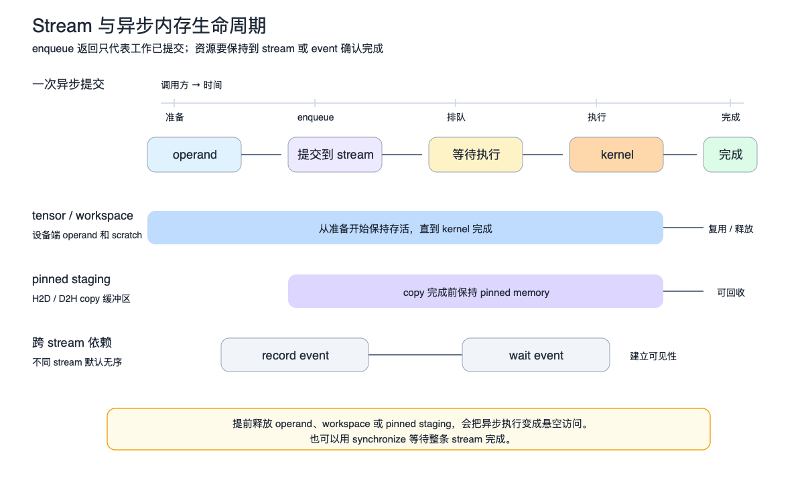

VMM、IPC、GraphCapture 和 ComputePartition 通过 context 的 optional service 暴露。当前 CPU/CUDA 的 graph capture 都尚未接入；CPU 用模拟 VMM、进程内 collective 和 POSIX shared\-memory IPC 覆盖主要生命周期。

### 算子与执行：

#### 算子分组

|分组|主要内容|
|---|---|
|Norm / Elementwise / Position|RMSNorm、residual add、门控激活和 RoPE|
|Matmul / Quant|普通与量化 GEMM、grouped GEMM、activation quantize|
|Attention / LinearAttention|paged attention、Gated DeltaNet、conv 和 recurrent state|
|Transform / Sampling|materialize、cast、logits 过滤和采样|
|Collective|TP all\-reduce、send/recv|

backend 根据 shape、dtype 和 capability 选择 variant，调用方使用同一 operation signature。`LaunchInfo::variant` 将实际选择结果带回 trace；不支持的路径返回 `KernelError::Unsupported`。

#### Executor dispatch

Executor 是单 stream 的调用门面。每个 wrapper 与底层 operation 同名，统一经过 sizing/trace hooks 和 backend launch；模型层在上层组织模型语义，多 Worker 调度由 Engine 侧完成。

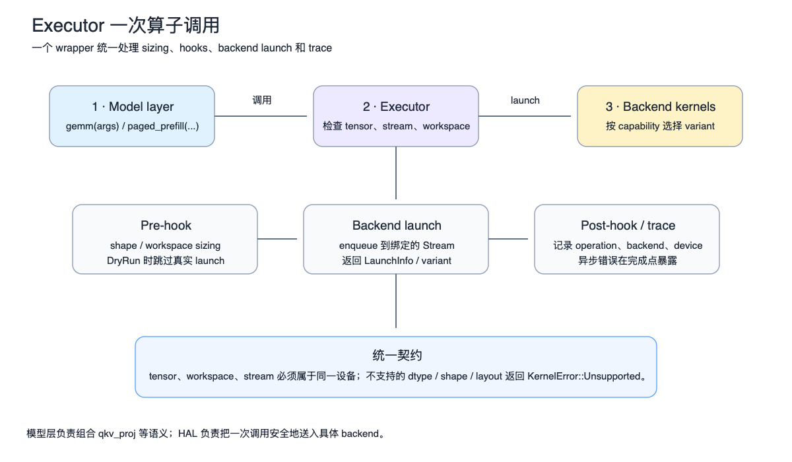

sizing 模式通过 `DryRun` pre\-hook 跳过真实 launch，但仍允许 shape 计算、workspace 查询和 arena allocation；trace post\-hook 记录 operation、backend、device、operand descriptor 和 variant。

### Attention prepare/execute：

paged attention 先查询 workspace 大小，再根据 ragged batch prepare，最后用同一份 prepared handle 执行 kernel。Engine 侧的 `PrefillPlan` 持有 workspace，并让同 shape 的 attention layer 复用准备结果。

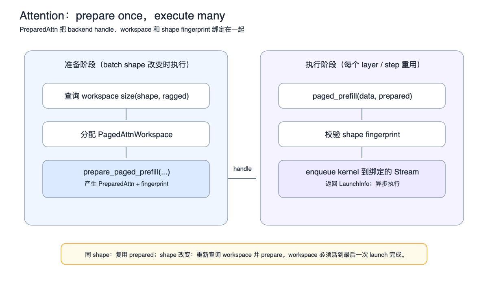

prepared handle 必须与 batch shape、ragged 结构和 workspace 匹配。当前 fingerprint 只做部分汇总值的 debug 校验，完整一致性仍由调用方保证。

### CPU与CUDA backend：

#### CPU

CPU backend 提供语义参考实现，也可以端到端运行。stream 在调用线程内同步执行，算子以 scalar 为基础并提供部分 SIMD/快速 variant；进程内 collective、VMM 模拟和 POSIX shared\-memory IPC 用于覆盖无 GPU 主机上的 Engine 生命周期。

#### CUDA

CUDA backend 将 vendor 调用隔离在自身的 ops/FFI 和设备资源模块内：FlashInfer 用于 attention、norm、sampling、RoPE，cuBLAS 用于浮点 GEMM，DeepGEMM 用于 FP8 grouped GEMM，NCCL 用于 TP 通信，自研 kernel 补充 elementwise、transform、quant 和 Gated DeltaNet。具体能力由 cargo feature、驱动和设备共同决定，Registry 在启动时选择可用 backend，Engine 无需增加 CPU/CUDA 分支。

### 扩展方式与约束：

新增算子时，先在 `hal_api` 声明 operand、shape、workspace 和错误契约，再增加 Executor wrapper、CPU reference 实现和 CUDA 实现。新增硬件时，实现 backend、context、kernels 并注册 plugin，Engine 继续使用同一套 HAL 接口。

- tensor、stream 和 workspace 必须属于同一设备。

- 异步数据在完成前必须保持存活。

- backend 必须报告真实可用的 capability。

- 算子参数错误由 HAL 返回，调度容量和 cache 策略由 Engine 处理。

## 七\.weight

## 八\.编译构建

## 九\.附录

当前性能现状：

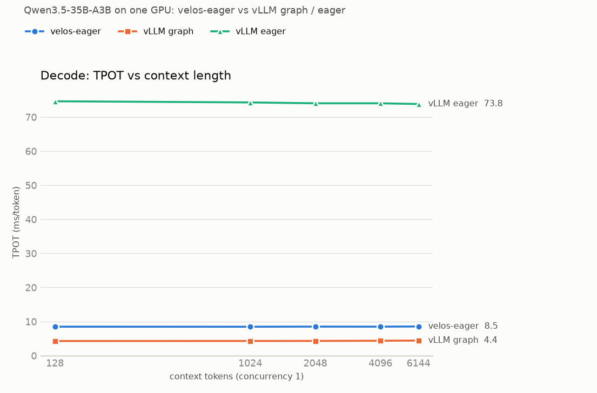

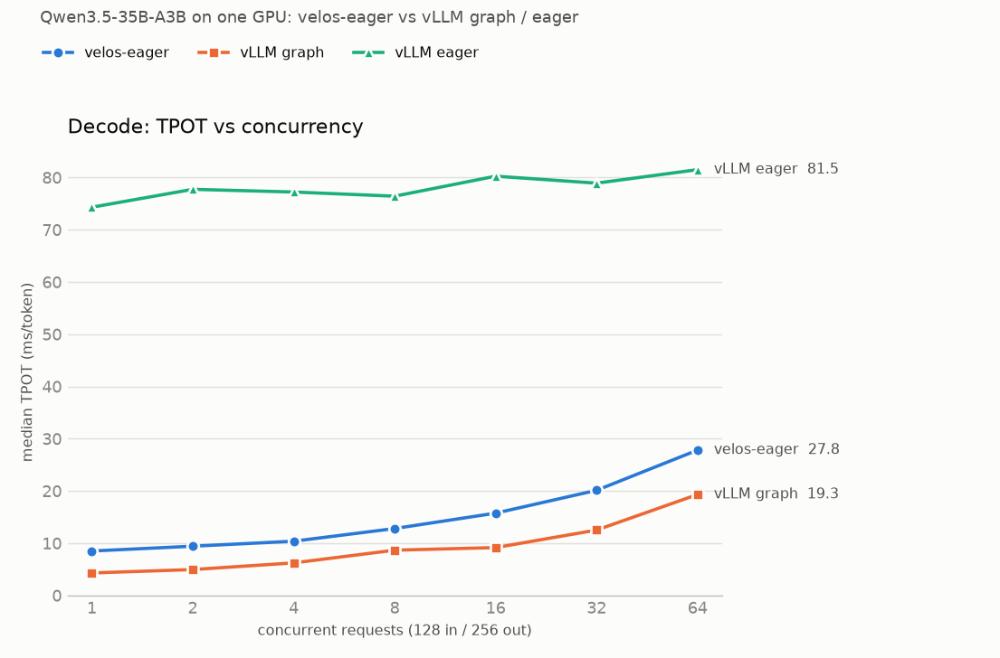

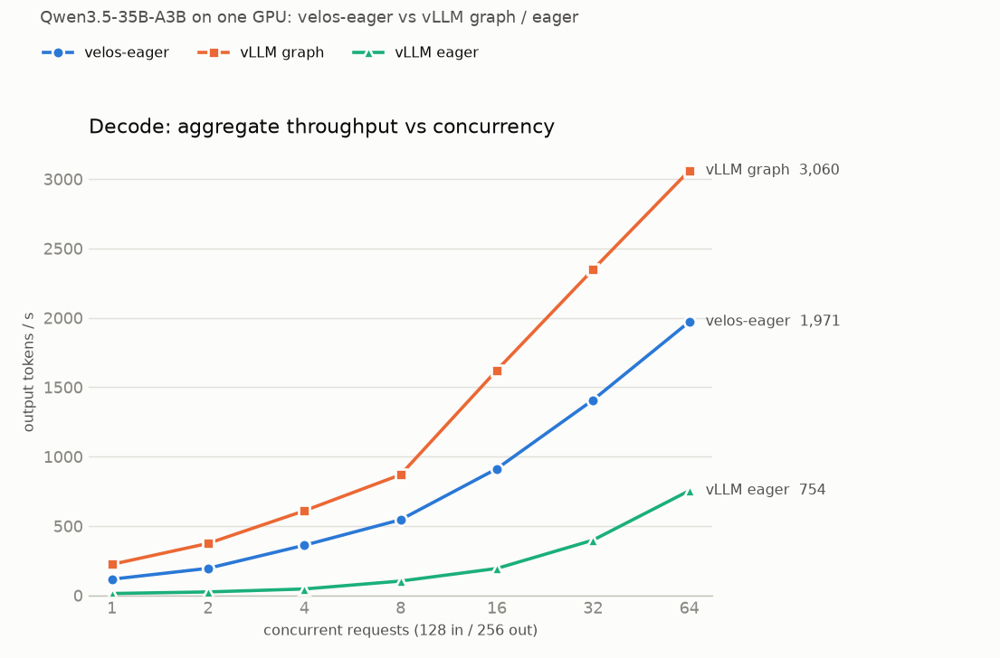

当前只简单调优的decode时延，且没有图模式，时延明显低于vllm\-eager。下一步调优吞吐和prefill性能

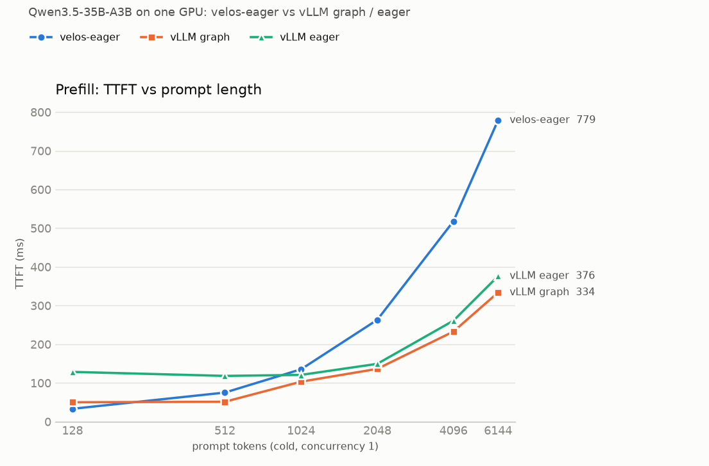

